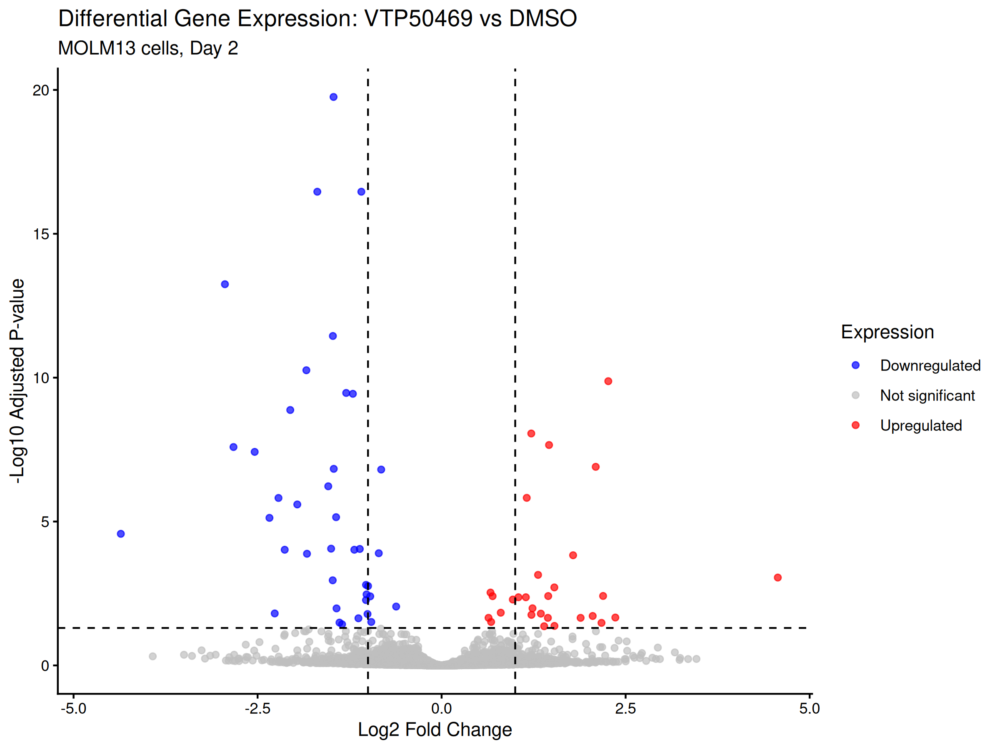
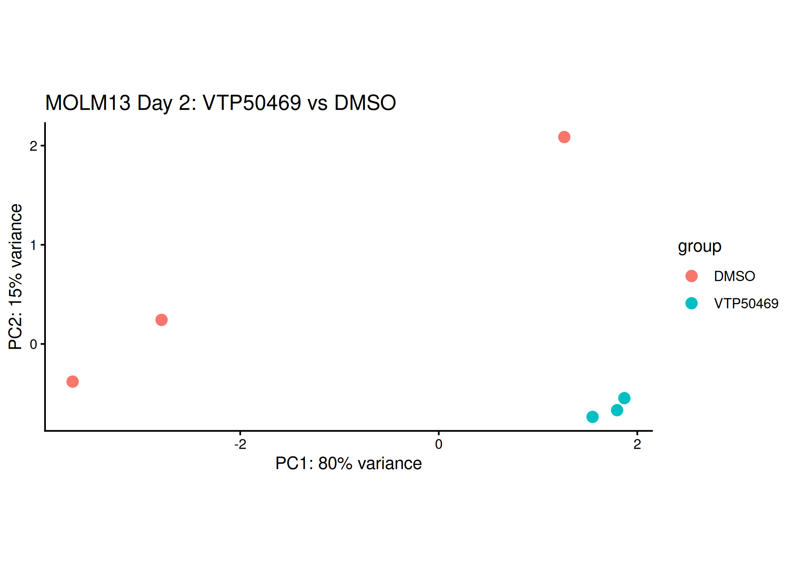
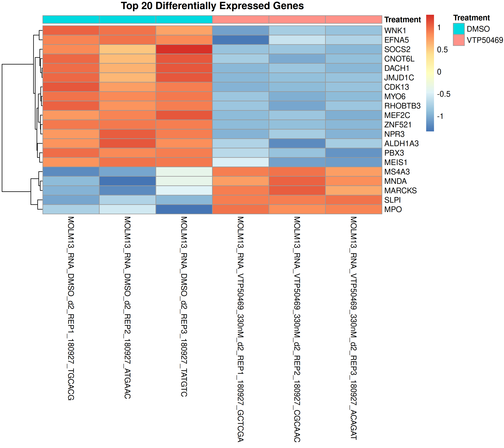
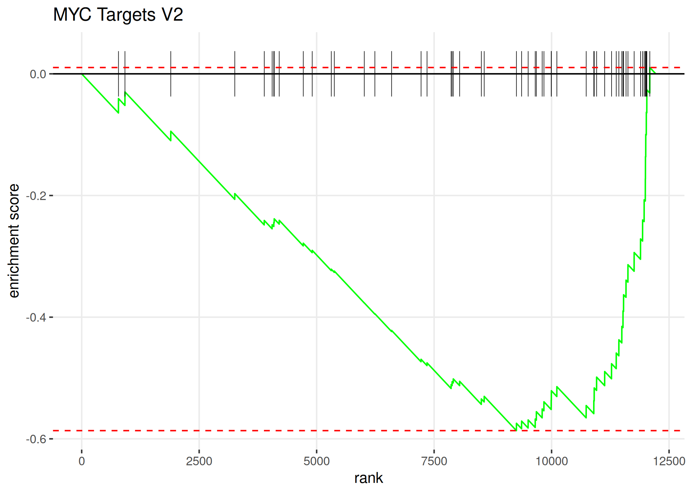
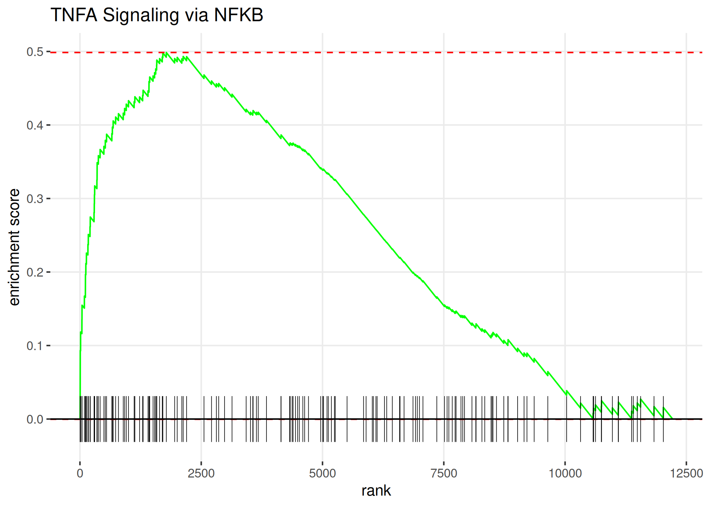

# Menin Inhibition in KMT2A-Rearranged Leukemia — Bulk RNA-seq Reanalysis



*Transcriptional response to the menin inhibitor VTP-50469 in KMT2A-rearranged MOLM13 cells — DESeq2 + Hallmark GSEA reanalysis of [GSE127506](https://www.ncbi.nlm.nih.gov/geo/query/acc.cgi?acc=GSE127506) (Krivtsov et al., *Cancer Cell* 2019).*

## Overview

KMT2A (MLL)-rearranged leukemia depends on the menin–KMT2A interaction to sustain the *HOXA*/*MEIS1* self-renewal program. This repository reanalyzes published bulk RNA-seq from MOLM13 cells treated with the menin inhibitor **VTP-50469** versus DMSO (Day 2, three replicates per arm) to ask a focused question: at the transcriptome level, does menin inhibition collapse the canonical MLL-fusion target program, and which pathways move with it?

The pipeline starts from GEO's processed gene-level counts and runs a standard DESeq2 → preranked GSEA workflow in R, versioned end to end.

## Background

Menin is a chromatin adaptor that MLL fusion oncoproteins require to drive the *HOXA*/*MEIS1* program underlying KMT2A-rearranged leukemia. Pharmacologic disruption of the menin–KMT2A interaction collapses that program and forces leukemic differentiation — the basis of the original study reanalyzed here and of the menin inhibitors now in clinical use. This reanalysis recovers the on-target signature transcriptionally and connects to current translational work that pairs menin inhibition with MEK inhibition in RAS-pathway-mutant disease and uses single-cell dissection of blast states to predict drug response (see [References](#references)).

## Data and design

| | |
|---|---|
| GEO accession | [GSE127506](https://www.ncbi.nlm.nih.gov/geo/query/acc.cgi?acc=GSE127506) |
| Cell line | MOLM13 (KMT2A-rearranged AML) |
| Contrast | VTP-50469 (330 nM) vs DMSO, Day 2 |
| Replicates | 3 vs 3 |
| Input | Gene-level 3′-tag counts (23,710 features) |

Counts come from GEO's processed matrix; the six MOLM13 Day-2 columns are extracted for analysis.

## Methods

Features with fewer than 10 total reads are filtered, and differential expression is tested with DESeq2 (`design = ~ treatment`, DMSO as reference, Wald test, contrast VTP-50469 vs DMSO). Genes are ranked by the Wald statistic for preranked GSEA against the MSigDB Hallmark collection (`fgsea`). Quality control covers variance-stabilizing transformation, PCA, pairwise sample correlation, and per-sample normalized-count distributions.

## Results

### The menin–KMT2A target program is suppressed

The most strongly downregulated genes are the canonical MLL-fusion targets, consistent with on-target menin inhibition:

| Gene | log2FC | padj |
|---|---:|---:|
| MEF2C | −1.47 | 1.8 × 10⁻²⁰ |
| PBX3 | −1.84 | 5.5 × 10⁻¹¹ |
| MEIS1 | −2.54 | 3.8 × 10⁻⁸ |
| JMJD1C | −0.82 | 1.6 × 10⁻⁷ |
| FLT3 | −0.62 | 9.0 × 10⁻³ |

68 genes pass padj < 0.05 (29 up, 39 down). The identity and direction of the top hits match the expected collapse of the *HOXA*/*MEIS1* axis on menin inhibition.



*PCA — samples separate by treatment along PC1.*


*Volcano — 29 up / 39 down at padj < 0.05.*



*Top differentially expressed genes (z-scored normalized counts).*

### Pathway enrichment

Preranked GSEA returns 14 Hallmark pathways at padj < 0.05. The mechanistically informative result is negative enrichment of **MYC Targets V2 (NES −2.24)**: the MYC-driven program is suppressed even though *MYC* itself is not individually significant (log2FC −0.25, padj 0.91). Stress and inflammatory sets (TNFα via NF-κB, hypoxia, apoptosis, IL6/JAK-STAT3) are positively enriched, consistent with a secondary cellular response rather than the primary on-target effect. Overt differentiation markers (*ITGAM*, *CD14*, *CEBPA*) are not yet moved at Day 2 — expected for this early timepoint.



*MYC Targets V2 — negatively enriched after menin inhibition.*



*TNFα signaling via NF-κB — positively enriched.*

## Reproduce

```bash
conda env create -f environment.yml && conda activate menin-rnaseq

bash    scripts/01_download_GEO_counts.sh    # GEO counts + metadata  -> data/
Rscript scripts/02_build_counts_matrix.R     # select MOLM13 Day 2    -> data/processed, data/metadata
Rscript scripts/03_deseq2_GSE127506.R        # DESeq2 + GSEA + figures
```

Run from the repository root. Tabular outputs (DE results, Hallmark GSEA) are written to `results/`; the rendered figures above are in `figures/`.

## Layout

```text
├── scripts/            # 01 download · 02 build counts · 03 DESeq2 + GSEA
├── data/               # raw (gitignored) · processed · metadata
├── results/            # DESeq2 and GSEA tables
├── figures/            # figures shown above
├── archive/            # earlier STAR/featureCounts workflow (not used in the final analysis)
└── environment.yml     # conda environment
```

The `archive/` directory holds a FASTQ→STAR→featureCounts workflow kept for reference; the analysis in this repo uses GEO's processed counts rather than raw reads.

## Limitations

- Reanalysis of published data (Krivtsov et al., 2019) for portfolio and methods demonstration — not an independent experiment.
- One cell line, one dose, one timepoint; differentiation and durability of response would require the Day-7 and second-line arms of the original series.
- 3′-tag gene-level counts — no transcript-level or isoform interpretation.
- Starts from processed counts, so no raw-read alignment or independent read-level QC.
- GSEA reports coordinated expression patterns, not direct evidence of pathway activity.

## References

1. Krivtsov AV, Evans K, Gadrey JY, et al. **A menin–MLL inhibitor induces specific chromatin changes and eradicates disease in models of MLL-rearranged leukemia.** *Cancer Cell.* 2019;36(6):660–673. — source of the reanalyzed data ([GSE127506](https://www.ncbi.nlm.nih.gov/geo/query/acc.cgi?acc=GSE127506)).
2. Pikman Y, et al. **Single-cell panleukemia signatures of HSPC-like blasts predict drug response and clinical outcome.** 2025. [PubMed 40089994](https://pubmed.ncbi.nlm.nih.gov/40089994/).
3. Pikman Y, et al. **Combining menin and MEK inhibition to target poor-prognosis KMT2A-rearranged, RAS-pathway-mutant acute myeloid leukemia.** *Blood.* 2023;142(Suppl 1) (ASH Annual Meeting abstract).

---

Reanalysis by Anagha Kaduskar. Data from GEO accession GSE127506 (Krivtsov et al., *Cancer Cell* 2019).
